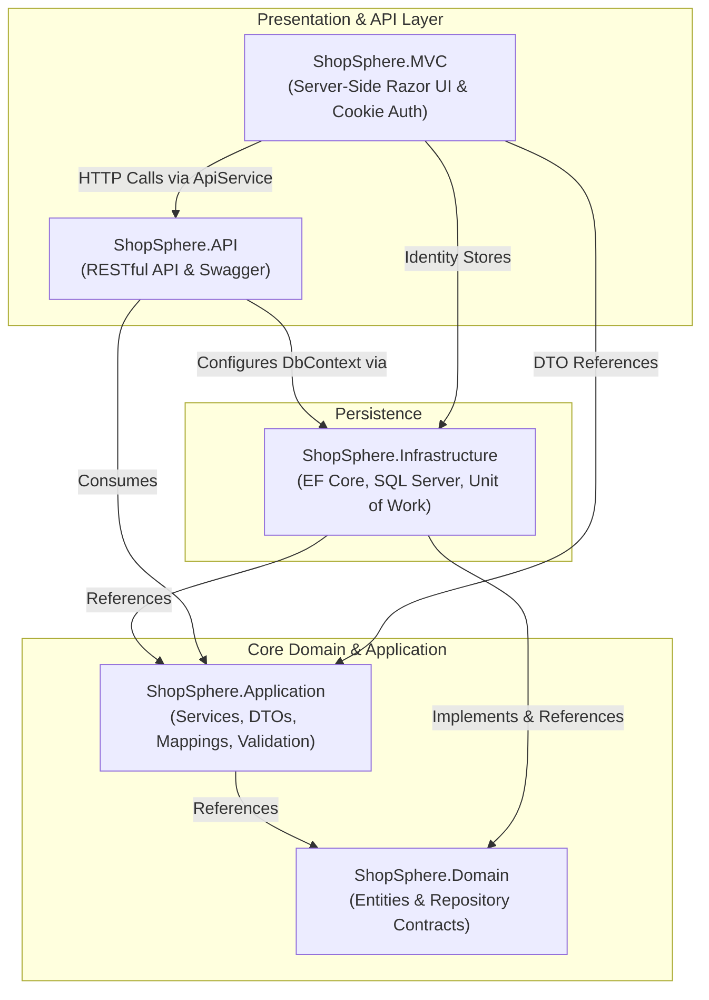
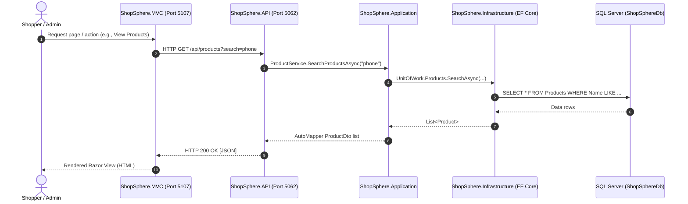

# System Architecture & Design

This document details the architectural principles, layers, component interactions, and design patterns utilized in **ShopSphere**.

---

## 1. Architectural Style: Clean Architecture

ShopSphere follows the principles of **Clean Architecture** (also known as Onion or Hexagonal Architecture). The core business logic and entities are decoupled from data access implementations, external frameworks, and presentation layers.

### Dependency Rule
Dependencies strictly point inwards toward the Domain:
1. **ShopSphere.Domain** has **zero dependencies** on external frameworks, databases, or UI libraries (except standard Identity core contracts).
2. **ShopSphere.Application** depends only on `ShopSphere.Domain`.
3. **ShopSphere.Infrastructure** implements interfaces declared in `Domain` and uses `Application`.
4. **ShopSphere.API** coordinates dependencies and exposes endpoints to clients.
5. **ShopSphere.MVC** renders the customer-facing and administrative interface, delegating data operations to `ShopSphere.API` via an HTTP service (`ApiService`).

---

## 2. Project Breakdown & Responsibilities

### `ShopSphere.Domain`
* **Role**: The heart of the software. Contains enterprise business entities and domain abstractions.
* **Entities**:
  * `ApplicationUser`: Extends ASP.NET Core Identity's `IdentityUser`.
  * `Customer`: Represents customer profile details.
  * `Product`: Product details, SKU/name, pricing, inventory stock, and category relationships.
  * `Category`: Classification hierarchy for products.
  * `Order` & `OrderItem`: Order aggregates containing shipping info, total calculation, order status, and payment attributes.
  * `Cart` & `CartItem`: Persistent shopping cart definitions.
  * `ProductItem`: Product variation/item definition.
* **Contracts**:
  * `IGenericRepository<T>`: Standard CRUD abstraction (`GetAllAsync`, `GetByIdAsync`, `AddAsync`, `Update`, `Delete`).
  * `IProductRepository`, `ICategoryRepository`, `IOrderRepository`: Entity-specific repository contracts.
  * `IUnitOfWork`: Coordinates multiple repositories and transactional saves (`CompleteAsync`).

### `ShopSphere.Application`
* **Role**: Business logic, data transformation, and application orchestration.
* **Data Transfer Objects (DTOs)**:
  * `ProductDto`, `ProductFilterDto`
  * `CategoryDto`
  * `OrderDto`, `OrderItemDto`, `CheckoutDto`
  * `CartDto`, `CartItemDto`
  * `DashboardDto`, `PagedResult<T>`, `LoginDto`, `RegisterDto`
* **Object Mapping**:
  * Configured via **AutoMapper** (`MappingProfile`) for bidirectional mapping between Domain Entities and DTOs.
* **Validation**:
  * **FluentValidation** implementations (`ProductDtoValidator`, `CategoryDtoValidator`, `OrderDtoValidator`) enforcing constraints on length, pricing, and required fields.
* **Services**:
  * `IProductService` / `ProductService`: Product search, category filtering, catalog management.
  * `ICategoryService` / `CategoryService`: Category CRUD and hierarchy operations.
  * `IOrderService` / `OrderService`: Order creation, checkout orchestration, status transitions.

### `ShopSphere.Infrastructure`
* **Role**: Technical capabilities, database persistence, and external service communication.
* **Data Context**:
  * `ApplicationDbContext`: Inherits from `IdentityDbContext<ApplicationUser>`, configured for Microsoft SQL Server.
  * Model configurations (`decimal(18,2)` precision, entity relations).
  * Data seeding inside `OnModelCreating` (5 categories and 12 pre-configured sample products).
* **Repository Implementations**:
  * `GenericRepository<T>`
  * `ProductRepository`, `CategoryRepository`, `OrderRepository`
  * `UnitOfWork`: Encapsulates database transactions via EF Core.
* **Migrations**:
  * Contains EF Core migration snapshots (`InitialMigration`, `SeedUpdates`).
* **Identity Seeding**:
  * `DataSeeder.cs`: Seeds default `Admin` and `User` roles, with optional admin user bootstrapping (`admin@shopsphere.com`).

### `ShopSphere.API`
* **Role**: Exposes secure RESTful HTTP endpoints for data access and admin dashboards.
* **Controllers**:
  * `ProductsController`: Catalog search, filtering, and CRUD.
  * `CategoriesController`: Category hierarchy and CRUD.
  * `OrdersController`: Order lifecycle and checkout submission.
  * `DashboardController`: Aggregate metrics for administrative overview and user queries.
* **Cross-Cutting Concerns**:
  * **Serilog**: Console and daily rolling file logging (`logs/api-log-.txt`).
  * **Swagger / Swashbuckle**: Interactive API documentation at `/swagger`.
  * **Global Exception Handling**: Custom middleware (`GlobalExceptionMiddleware`) formatting internal exceptions into structured JSON responses.

### `ShopSphere.MVC`
* **Role**: Server-rendered interactive web client for shoppers and administrators.
* **Controllers**:
  * `HomeController`: Hero landing page, featured categories, and trending products.
  * `ProductController`: Product catalog, detailed views, search, and category browsing.
  * `CartController`: In-memory session cart operations (Add, Remove, Quantity adjustments).
  * `CheckoutController`: Shipping input, checkout calculation, payment method selection, and API order submission.
  * `AccountController`: Cookie-based authentication, login, registration, role assignment, and session migration.
  * `AdminController`: Protected administrative management (Manage Products, Manage Categories, Manage Orders, Metrics Dashboard).
  * `UserController`: Customer dashboard and personal order history.
  * `WishlistController`: Client-side saved products list.
* **Integration**:
  * `ApiService`: Typed `HttpClient` configured to target `http://localhost:5062/api/`.

---

## 3. Communication & Runtime Flow

---

## 4. Design Patterns Applied

| Pattern | Location | Purpose |
| :--- | :--- | :--- |
| **Repository Pattern** | `ShopSphere.Domain.Repositories` & `ShopSphere.Infrastructure.Repository` | Decouples data query and persistence logic from business services. |
| **Unit of Work** | `IUnitOfWork` & `UnitOfWork` | Maintains a single database transaction across multiple repository updates. |
| **Data Transfer Object (DTO)** | `ShopSphere.Application.DTOs` | Prevents over-posting, protects domain models, and optimizes payload transmission. |
| **Dependency Injection** | ASP.NET Core IoC Container (`Program.cs`) | Enforces loose coupling and testability by injecting services and repositories via interfaces. |
| **Typed HttpClient** | `ApiService` in `ShopSphere.MVC` | Encapsulates HTTP serialization, deserialization, and API route details. |
| **Session-Based Cart with Migration** | `CartController` & `AccountController` | Allows anonymous guests to build carts, seamlessly merging items to their account upon authentication. |
