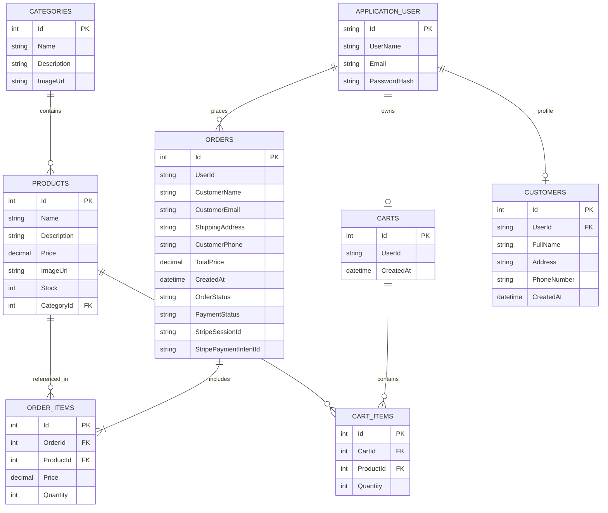

# Database Schema & Migrations Guide

This document outlines the database design, entity relationships, Entity Framework Core migrations, and initial seed data for **ShopSphere**.

---

## 1. Database Architecture & Technology

* **Database Engine**: Microsoft SQL Server (tested with SQL Server LocalDB).
* **ORM**: Entity Framework Core 8 (`Microsoft.EntityFrameworkCore.SqlServer 8.0.0`).
* **Identity Provider**: ASP.NET Core Identity (`IdentityDbContext<ApplicationUser>`).
* **Connection String**: Configured in `appsettings.json` under `ConnectionStrings:DefaultConnection`.

```json
"ConnectionStrings": {
  "DefaultConnection": "Server=(localdb)\\MSSQLLocalDB;Database=ShopSphereDb;Trusted_Connection=True;MultipleActiveResultSets=true;Encrypt=False"
}
```

---

## 2. Entity-Relationship Diagram (ERD)



---

## 3. Entity Relationships & Configurations

* **Product - Category**: A foreign key relationship where each `Product` belongs to one `Category` via `CategoryId`.
* **Order - OrderItem**: An `Order` contains multiple line items. If an `Order` is deleted, related `OrderItems` cascade accordingly.
* **Cart - CartItem**: Persistent shopping carts for authenticated customer accounts.
* **Currency & Precision**: All monetary values (`Product.Price`, `OrderItem.Price`, `Order.TotalPrice`) are explicitly configured with `decimal(18,2)` column precision in `ApplicationDbContext.OnModelCreating`.

---

## 4. Entity Framework Core Migrations

Migrations are stored in `ShopSphere.Infrastructure/Migrations/`.

### Existing Migrations
1. `20260608230954_InitialMigration`:
   - Creates the core schema (`Categories`, `Products`, `Orders`, `OrderItems`, `Carts`, `CartItems`, `Customers`).
   - Generates default ASP.NET Identity tables (`AspNetUsers`, `AspNetRoles`, `AspNetUserRoles`, etc.).
   - Seeds initial category and product data.
2. `20260608234206_SeedUpdates`:
   - Updates seed records with revised Arabic product names, descriptions, high-resolution Unsplash image links, and category IDs.

### Migration Commands (CLI)

Run all migration commands from the solution root:

#### Apply Migrations to Database
```bash
dotnet ef database update --project ShopSphere.Infrastructure --startup-project ShopSphere.API
```

#### Add a New Migration
```bash
dotnet ef migrations add <MigrationName> --project ShopSphere.Infrastructure --startup-project ShopSphere.API
```

#### Revert the Last Migration
```bash
dotnet ef migrations remove --project ShopSphere.Infrastructure --startup-project ShopSphere.API
```

#### Generate a SQL Migration Script
```bash
dotnet ef migrations script --project ShopSphere.Infrastructure --startup-project ShopSphere.API -o migrate.sql
```

---

## 5. Seed Data Details

### Seeded Categories
The database automatically seeds 5 default product categories:
1. **إلكترونيات (Electronics)**: Phones, laptops, and smart gadgets.
2. **ملابس (Apparel)**: Casual and formal wear.
3. **كتب (Books)**: Novels, educational literature, and self-help.
4. **أجهزة منزلية (Home Appliances)**: Blenders, coffee makers, and kitchen tools.
5. **ألعاب وقيمينج (Gaming)**: Consoles, graphic cards, and gaming accessories.

### Seeded Products
Twelve catalog products are pre-seeded with pricing, inventory stocks, and Unsplash imagery (including gaming laptops, wireless earbuds, smartwatches, running shoes, and bestselling books).

### Identity Roles Seeding
On application startup in `ShopSphere.API/Program.cs`, the service automatically verifies and seeds the two system roles:
* `Admin`: Grants administrative portal access (`/Admin/*`).
* `User`: Default role for registered shoppers (`/User/*`).
