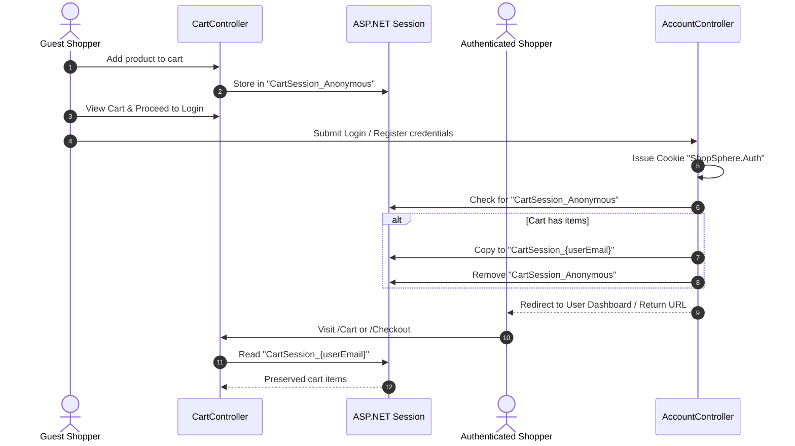
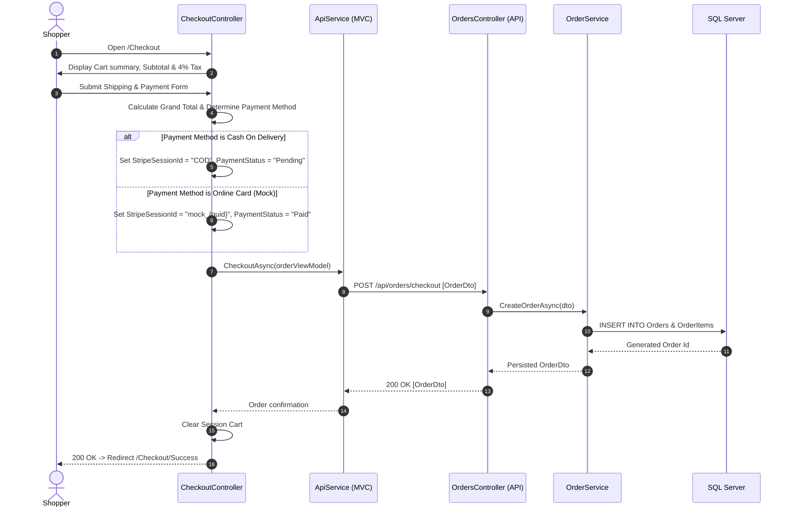

# Business Workflows & Feature Guide

This guide details the core user journeys, business logic implementations, and workflows within **ShopSphere**.

---

## 1. Shopping Cart & Guest-to-User Session Migration

ShopSphere provides a guest shopping experience where unauthenticated visitors can browse and add items to a cart before creating an account.

### Workflow Sequence

### Key Implementation Details
* **Storage**: In-memory JSON serialization in ASP.NET Core Session.
* **Session Lifetime**: 20 minutes idle timeout (configured in `ShopSphere.MVC/Program.cs`).
* **Key Generation**: 
  * Unauthenticated: `CartSession_Anonymous`
  * Authenticated: `CartSession_{userEmail}`

---

## 2. Checkout & Order Placement Workflow

### Pricing & Tax Rules
* **Subtotal**: Sum of `(Price * Quantity)` for all cart items.
* **Tax**: Automatically calculated as `4%` of subtotal (`subTotal * 0.04m`).
* **Grand Total**: `subTotal + tax`.

---

## 3. Authentication & Role-Based Access Control

### Authentication Mechanism
* Uses ASP.NET Core **Cookie Authentication** (`CookieAuthenticationDefaults.AuthenticationScheme`).
* Cookie Name: `ShopSphere.Auth`.
* Cookie Options: `HttpOnly = true`, `IsEssential = true`.

### Role Resolution Logic
In `AccountController.cs`:
* **Admin Role**: Any email address containing the string `"admin"` (case-insensitive) is granted the `Admin` role.
  * Redirects upon login to `/Admin/Dashboard`.
* **User Role**: Standard email addresses receive the `User` role.
  * Redirects upon login to `/User/Dashboard`.

---

## 4. Administrative Management Workflows

Administrators have access to a dedicated suite of tools under `/Admin/*`:

| Feature | Route | Functionality |
| :--- | :--- | :--- |
| **KPI Dashboard** | `/Admin/Dashboard` | Displays total revenue, orders count, product catalog size, customer count, and latest catalog additions. |
| **Product Management** | `/Admin/ManageProducts` | Catalog listing with direct links to Add, Edit, and Delete products. |
| **Add Product** | `/Admin/AddProduct` | Form validating title, price, stock, category assignment, and image URL. |
| **Edit Product** | `/Admin/EditProduct/{id}` | Updates existing catalog pricing, stock inventory, and metadata. |
| **Category Management** | `/Admin/Categories` | Manage product classifications and category images. |
| **Order Management** | `/Admin/Orders` | View incoming orders, inspect item details via dynamic AJAX partial view (`_OrderDetailsPartial`), and change statuses (`Pending`, `Processing`, `Shipped`, `Delivered`). |
| **User Directory** | `/Admin/Users` | Review registered shopper accounts. |

---

## 5. Catalog Search & Category Filtering

* **Full-Text Search**: Users can search by keyword from the navigation search bar. Calls `GET /api/products?search={term}`.
* **Category Filtering**: Clicking on category cards or sidebar links triggers `GET /api/products?categoryId={id}`.
* **Client-side Rendering**: Product cards show current stock availability, formatted currency, high-resolution imagery, and direct "Add to Cart" triggers.
